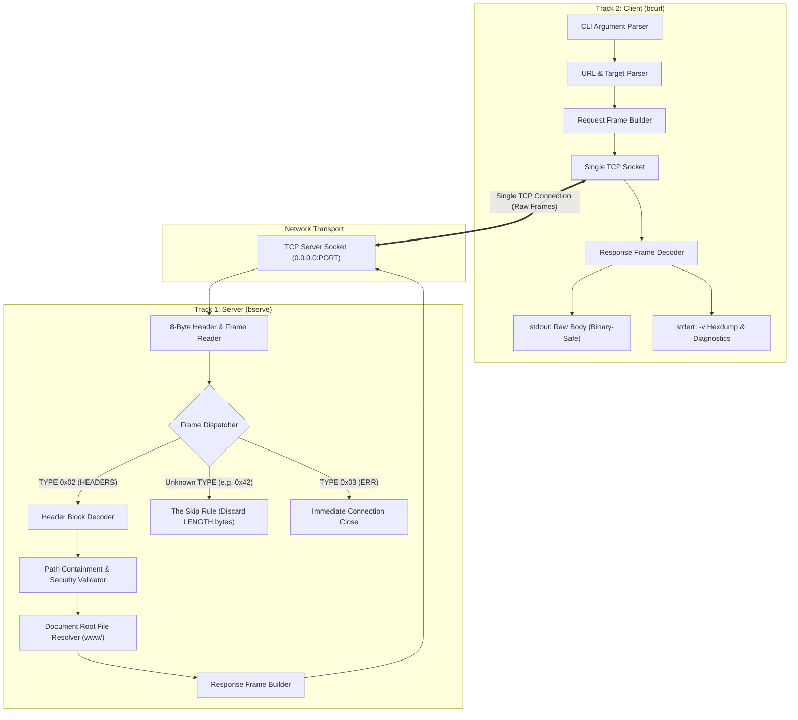
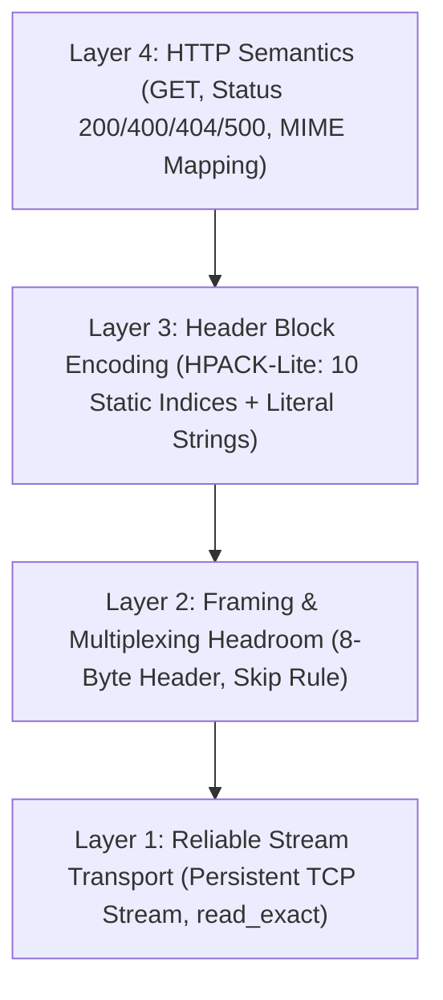
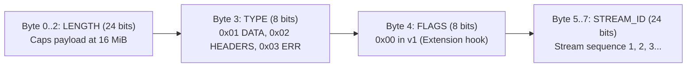
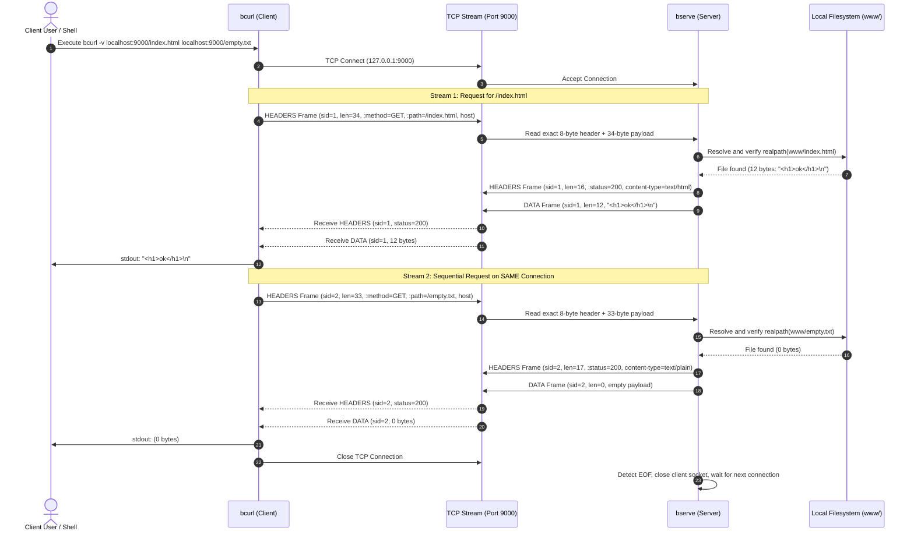
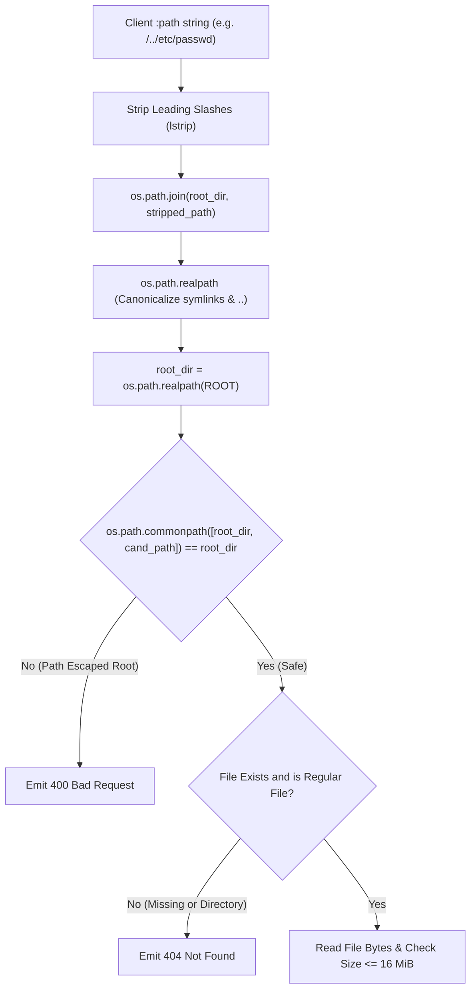

# BCURLP/1 System Architecture

This document specifies the structural architecture, protocol layer separation, wire framing mechanics, and component interactions of **BCURLP/1 (Binary Curl Protocol, Version 1)**.

---

## 1. System Overview

BCURLP/1 is a streamlined binary application protocol designed to deliver HTTP semantics over a single persistent TCP connection. It eliminates text-parsing overhead and line-oriented ambiguities by using fixed-width binary frame headers and HPACK-inspired header block encodings.



---

## 2. Layered Protocol Architecture

The protocol is partitioned into four distinct, non-overlapping architectural layers:



### Layer 1: Reliable Stream Transport
- **Mechanism**: Bare IPv4 TCP socket without TLS or handshakes.
- **Invariant**: The first byte on the socket is byte 0 of the first frame header.
- **Short-Read Protection**: All network reads must pass through a `read_exact(sock, n)` loop to handle TCP packet fragmentation.
- **Connection Lifecycle**: Single TCP connection. The client never opens a second socket; the server maintains the connection across sequential requests.

### Layer 2: Framing & The Skip Rule
- **Mechanism**: Uniform 8-byte fixed header preceding every payload.
- **Forward Compatibility Guarantee**: An implementation encountering an unrecognized frame `TYPE` MUST read the 8-byte header, read and discard exactly `LENGTH` payload bytes, and continue processing without connection termination or byte desynchronization.

### Layer 3: Header Block Encoding
- **Mechanism**: Compact two-mode serialization derived from HPACK (RFC 7541).
- **Indexed Form (`0x80 | index`)**: 1-byte control code selecting from the 10-entry static table, followed by a length-prefixed string value.
- **Literal Form (`0x00`)**: 1 control byte, length-prefixed string name, and length-prefixed string value.

### Layer 4: HTTP Semantics
- **Requests**: Only `GET` method supported. `:path` must begin with `/`. `host` header is mandatory.
- **Responses**: Exactly one `HEADERS` frame followed by exactly one `DATA` frame per request stream.

---

## 3. Frame Header Layout & Width Defense

Every frame transmitted over the wire begins with the fixed 8-byte header:

```
+---------------------------------------------------------------+
|                       BCURLP/1 Frame Header                   |
|                          (8 Bytes Total)                      |
+-------------------------------+---------------+---------------+
|       LENGTH (24 bits)        | TYPE (8 bits) | FLAGS (8 bits)|
|   Payload size (0..16,777,215)| 1=DATA 2=HDR  |     0x00      |
+-------------------------------+---------------+---------------+
|                     STREAM_ID (24 bits)                       |
|               Request/Response identifier (1..N)              |
+---------------------------------------------------------------+
|                      PAYLOAD (LENGTH Bytes)                   |
|                   DATA bytes / Header Entries                 |
+---------------------------------------------------------------+
```



### Architectural Defense of Chosen Widths
1. **LENGTH (24 bits, 3 bytes)**:
   - Caps corrupt or malicious payload allocations at exactly $16\,\text{MiB}$ ($16{,}777{,}215$ bytes).
   - Matches the default maximum frame payload of HTTP/2 (RFC 7540 §4.1).
   - Allows full-sized media and documentation files while enforcing bounded server memory.
2. **TYPE (8 bits, 1 byte)**:
   - Provides 256 distinct frame type opcodes. While v1 utilizes only 3 (`DATA`, `HEADERS`, `ERR`), the 8-bit width combined with the **Skip Rule** provides forward compatibility for version 2 extensions (`SETTINGS`, `PING`, `RST_STREAM`).
3. **FLAGS (8 bits, 1 byte)**:
   - Serves as the cheapest possible backward-compatible feature flag (e.g., `END_STREAM`, `END_HEADERS` in future iterations). Senders emit `0x00`; receivers accept any value.
4. **STREAM_ID (24 bits, 3 bytes)**:
   - Supports up to $16{,}777{,}215$ sequential streams per connection.
   - Combines with $24 + 8 + 8 = 40$ bits to form an exactly 64-bit ($8\text{-byte}$) word-aligned header. Aligned headers are trivial to parse with standard bitwise shifts and easy to inspect in hex dumps.

---

## 4. End-to-End Exchange Sequence

The following sequence diagram illustrates a complete, persistent multi-request session:



---

## 5. Security & Isolation Architecture



1. **Path Traversal Immunization**:
   - Stripping leading `/` before joining avoids `os.path.join` discarding the document root.
   - Canonicalizing via `os.path.realpath` resolves `..` elements.
   - Enforcing `os.path.commonpath([root_dir, cand]) == root_dir` prevents the classic prefix vulnerability where `/srv/www-secret` would improperly match `/srv/www` under a naive `startswith` check.
2. **Buffer Exhaustion Defense**:
   - Frame `LENGTH` is capped at $16{,}777{,}215$ bytes by the 24-bit wire width.
   - String values within header blocks are capped at 255 bytes by the 1-byte length prefix.

---
BISHWAYAN CHATTERJEE -- 24BCS10200
