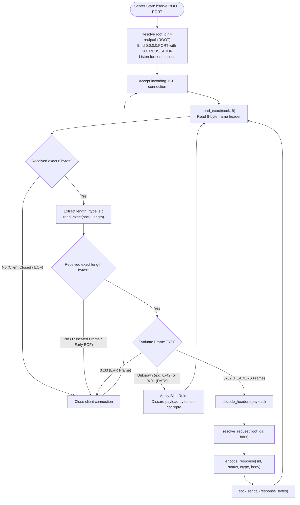
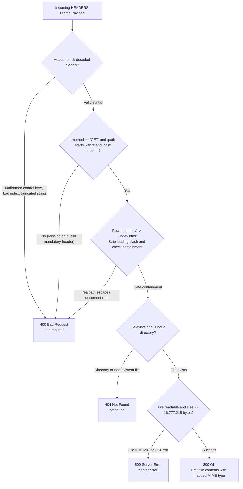
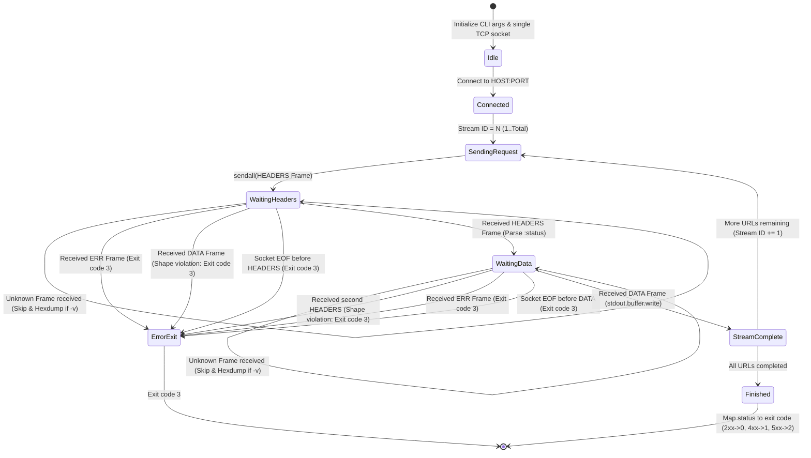
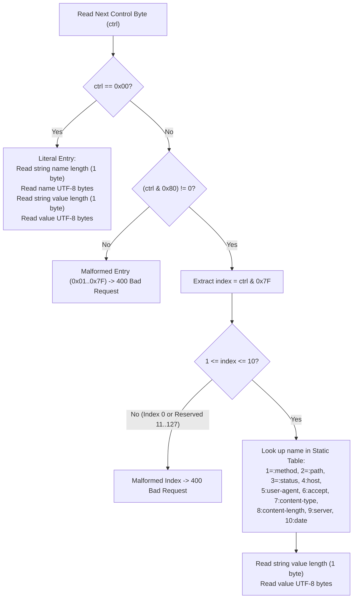
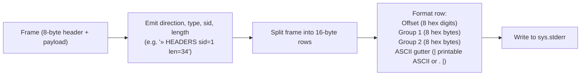

# BCURLP/1 Component Design & Implementation

This document describes the concrete software design, state machines, algorithmic flowcharts, and error-handling precedence implemented in **BCURLP/1**.

---

## 1. Server Engine Design (`bserve.py`)

The server is structured as an iterative, single-threaded connection handler that keeps the TCP socket open until the client disconnects or an error frame arrives.



### Precedence of Server Error Decisions
The server enforces a deterministic order of evaluation for every incoming request:



---

## 2. Client Engine Design (`bcurl.py`)

The client maintains an explicit response state machine for each URL requested on the connection.

### Response State Machine



### Multi-URL Single-Connection Loop
When invoked with multiple URLs (e.g. `bcurl localhost:9000/a localhost:9000/b`), the client:
1. Connects to `HOST:PORT` once at startup.
2. Iterates over URLs using sequential stream identifiers (`sid = 1, 2, 3...`).
3. Sends request $N$ and blocks until response $N$ (`HEADERS` then `DATA`) is fully received.
4. Writes body bytes sequentially to standard output.
5. Closes the socket only after the final URL completes.

---

## 3. Header Block Codec (HPACK-Lite)

The header block serialization uses HPACK's first two mechanisms: static table indexing and length-prefixed strings.



### Static Table Definition
| Index | Wire Byte | Header Name | Primary Role |
|---|---|---|---|
| 1 | `0x81` | `:method` | Mandatory in requests (`GET`) |
| 2 | `0x82` | `:path` | Mandatory in requests (starts with `/`) |
| 3 | `0x83` | `:status` | Mandatory in responses (`200`, `400`, `404`, `500`) |
| 4 | `0x84` | `host` | Mandatory in requests |
| 5 | `0x85` | `user-agent` | Optional metadata |
| 6 | `0x86` | `accept` | Optional content negotiation |
| 7 | `0x87` | `content-type` | Mandatory in responses (`text/html`, etc.) |
| 8 | `0x88` | `content-length` | Unused in v1 (frame LENGTH carries size) |
| 9 | `0x89` | `server` | Optional response header |
| 10 | `0x8A` | `date` | Optional response header |

---

## 4. Diagnostic Hexdump Formatter (`-v`)

The `-v` flag formats all sent and received frames directly to `stderr` with a two-column 16-byte hex dump and ASCII gutter:



Example formatted output:
```text
» HEADERS  sid=1 len=34
00000000  00 00 22 02 00 00 00 01  81 03 47 45 54 82 0b 2f  |..".......GET../|
00000010  69 6e 64 65 78 2e 68 74  6d 6c 84 0e 6c 6f 63 61  |index.html..loca|
00000020  6c 68 6f 73 74 3a 39 30  37 37                    |lhost:9077|
```

---

## 5. Conformance Rig Architectures

Two independent test rigs enforce protocol compliance using black-box oracles:

```mermaid
flowchart TD
    subgraph T1["Track 1 Rig: t1_rig.py (Fake Client)"]
        TC["19 Test Cases"] --> TSOCK["Open raw TCP socket to bserve"]
        TSOCK --> TSEND["Send canned test vectors"]
        TSEND --> TRECV["read_exact response frames"]
        TRECV --> TDIFF["Assert exact expected bytes and assert empty socket drain"]
    end

    subgraph T2["Track 2 Rig: t2_rig.py (Fake Server)"]
        T2S["Fake Server Socket on 127.0.0.1:PORT"] --> T2ACC["Accept connection\n(Tripwire: Fail if second accept occurs)"]
        T2ACC --> T2REQ["Decode bcurl request frame & assert semantics"]
        T2REQ --> T2RESP["Send canned response vector stamped with request sid"]
        T2RESP --> T2PROC["Subprocess: run bcurl.py"]
        T2PROC --> T2CHK["Assert stdout bytes, stderr contents, and exit code"]
    end
```



### The Second-Accept Tripwire
In `t2_rig.py`, Rule R1 (never open a second connection) is mechanically verified: after serving the requests for multi-URL tests, the rig sets a non-blocking timeout on `socket.accept()`. If `bcurl` attempts to open an auxiliary socket, the tripwire triggers and fails the test immediately.

---
BISHWAYAN CHATTERJEE -- 24BCS10200
